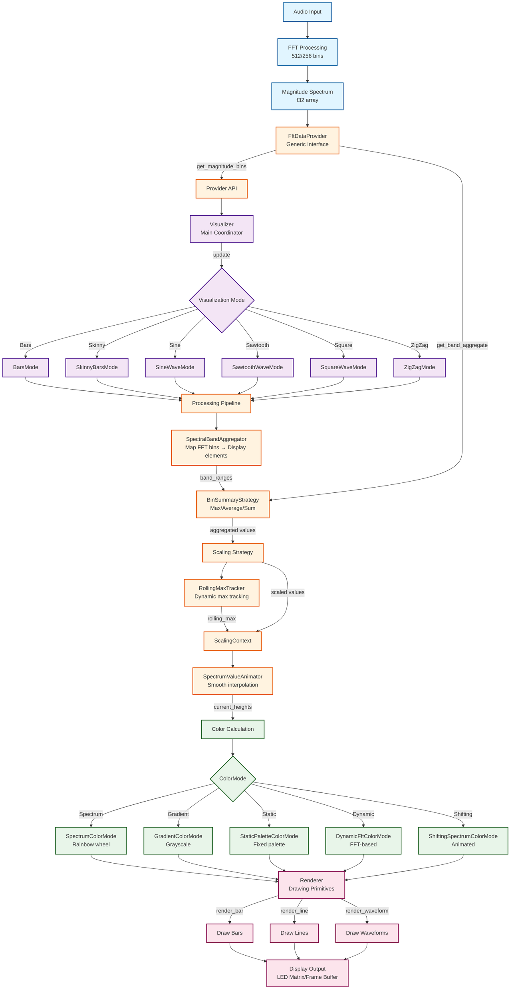
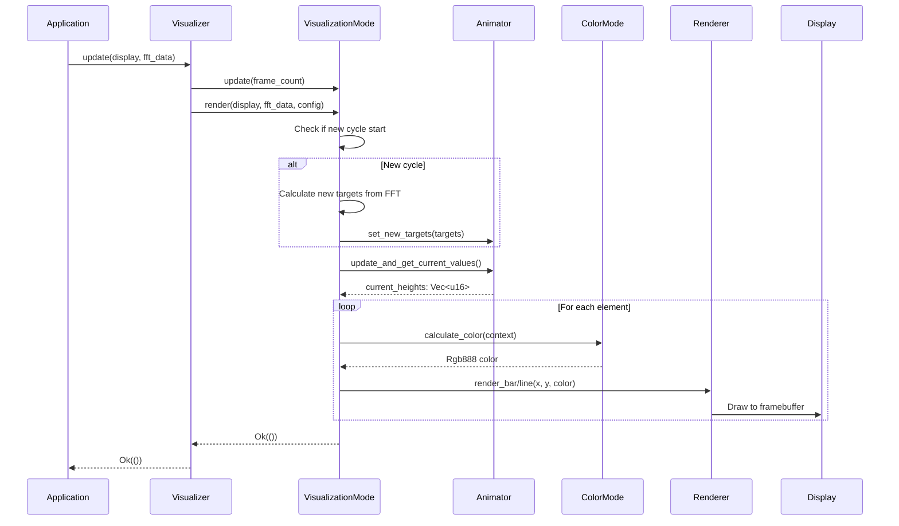
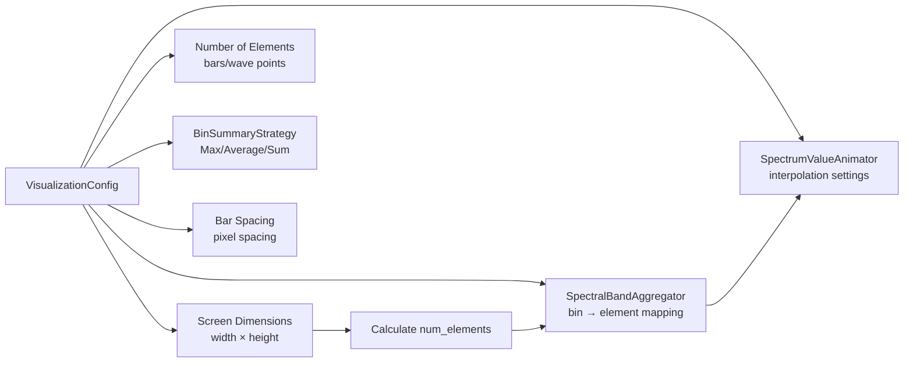

# Audio Visualization Pipeline

This document visualizes the complete audio processing and visualization pipeline in `micro-viz`.

## Pipeline Flow Diagram



## Component Details

### Input Layer
- **Audio Input**: Raw audio signal from microphone or audio source
- **FFT Processing**: Fast Fourier Transform converts time-domain to frequency-domain
- **Magnitude Spectrum**: Array of magnitude values (typically 512 bins)

### Data Provider Layer
- **FftDataProvider**: Generic trait interface that abstracts FFT data format
  - `FftArrayProvider`: Wraps `&[f32]` array
  - `FftVecProvider`: Wraps `Vec<f32>`
  - Direct array support: `[f32; N]`

### Visualization Layer
- **Visualizer**: Main coordinator that manages the visualization pipeline
- **VisualizationMode**: Trait for different visualization shapes
  - **BarsMode**: Standard vertical bars
  - **SkinnyBarsMode**: Thin bars with configurable spacing
  - **SineWaveMode**: Smooth sine wave interpolation
  - **SawtoothWaveMode**: Sawtooth waveform
  - **SquareWaveMode**: Square waveform
  - **ZigZagMode**: Zigzag pattern

### Processing Pipeline
1. **SpectralBandAggregator**: Maps FFT bins to display elements
   - Exponential or linear band distribution
   - Maps 512 bins → N display elements (e.g., 32 bars)

2. **BinSummaryStrategy**: Aggregates bin values within each band
   - `Max`: Take maximum value
   - `Average`: Take mean value
   - `Sum`: Sum all values

3. **Scaling Strategy**: Normalizes values to display coordinates
   - `LinearRollingMaxScaling`: Linear scaling with rolling max
   - `LogarithmicScaling`: Logarithmic scaling
   - `SquareRootScaling`: Square root scaling

4. **RollingMaxTracker**: Tracks dynamic maximum for adaptive scaling
   - Updates with decay factor
   - Prevents sudden jumps in visualization

5. **SpectrumValueAnimator**: Smoothly interpolates between value changes
   - Ease-out quadratic interpolation
   - Prevents choppy animations
   - Interpolates over N frames

### Color Processing
- **ColorMode**: Trait for color calculation strategies
  - **SpectrumColorMode**: Rainbow color wheel based on position
  - **GradientColorMode**: Grayscale intensity gradient
  - **StaticPaletteColorMode**: Fixed color palette cycling
  - **DynamicFftColorMode**: Colors based on FFT magnitude
  - **ShiftingSpectrumColorMode**: Animated shifting rainbow

### Rendering Layer
- **Renderer**: Low-level drawing primitives
  - `render_bar()`: Draws vertical bars
  - `render_line()`: Draws lines (for waves)
  - `render_waveform()`: Draws waveforms

### Output Layer
- **Display**: Final output to LED matrix or framebuffer
  - Uses `embedded-graphics` `DrawTarget` trait
  - RGB888 color format
  - Screen dimensions: typically 256x64

## Data Flow Example

```
1. Audio → FFT → [512 f32 magnitude values]

2. FftArrayProvider::new(&magnitude_array)
   → Provides generic FftDataProvider interface

3. Visualizer::update(&mut display, &fft_provider)
   → Selects visualization mode (e.g., BarsMode)

4. BarsMode::render()
   → Gets band ranges from SpectralBandAggregator
   → Aggregates bins using BinSummaryStrategy::Max
   → Scales using LinearRollingMaxScaling
   → Updates SpectrumValueAnimator with new targets
   → Gets current interpolated heights

5. For each bar:
   → Calculate color using ColorMode (e.g., SpectrumColorMode)
   → Render bar using Renderer::render_bar()

6. Display updated with new frame
```

## Frame Update Cycle



## Configuration Flow



## Key Design Principles

1. **Modularity**: Each component is independent and swappable
2. **Generic FFT Input**: Works with any FFT format via `FftDataProvider` trait
3. **Pluggable Modes**: Easy to add new visualization shapes
4. **Pluggable Colors**: Easy to add new color strategies
5. **Smooth Animation**: Value animator prevents choppy transitions
6. **Dynamic Scaling**: Rolling max adapts to signal level
7. **no_std Compatible**: All components work in embedded environments

